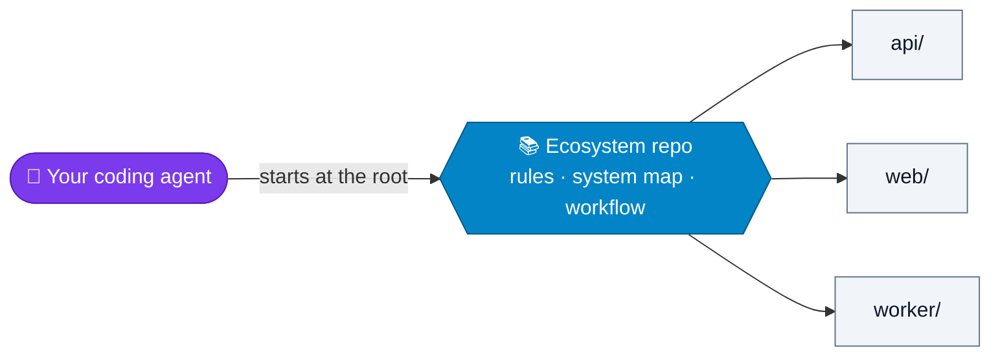
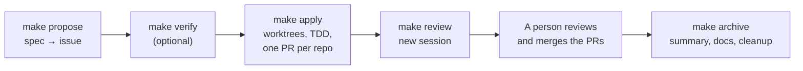

# agent-ecosystem

**Your repositories are an ecosystem. Give your AI coding agents the whole picture.**

Coding agents are great inside one repository, but most systems span several repositories: an agent working in
one of them cannot see the dependences with other repositories, so it proposes changes that are reasonable in isolation and
break something else. This template turns the folder where you clone all your services into a repo of its own,
the **ecosystem repository**, that gives every agent the shared rules, the contracts between
services and a spec-driven workflow for changes that cross repositories.



Works with any agent that takes a first message on the command line (Claude Code, Codex and
others), with or without [OpenSpec](https://github.com/Fission-AI/OpenSpec) or
[Superpowers](https://github.com/obra/superpowers), on GitHub or GitLab.

## Quick start

**Adopting it for your team** (one person, once; the full guide is [SETUP.md](SETUP.md)):

1. Click **Use this template** (or clone it and push it to your git host) and keep the new
   repo **private**: it describes how your system works and where it is fragile.
2. List your service repos in `repos.txt` and run `make sync`: it clones them side by side.
3. Fill in `AGENTS.md`, `docs/system-map.md` and `docs/product/`, then run `make doctor`
   until it shows no errors.

**Joining a team that already uses it:**

```bash
git clone <your-ecosystem-url> ecosystem && cd ecosystem
make sync          # or make sync-all to also clone the optional repos
printf 'AGENT = claude\nMETHOD = default\n' > local.mk    # your agent; see "Your agent" below
make doctor
```

Every `make` command is a shortcut for `bootstrap.sh` (see [Daily use](#daily-use)): without
`make`, run `./bootstrap.sh` directly. If you start your agent by hand, start it from the
ecosystem root, never from inside a service repo.

## How a change flows



Every change, feature or bug, has an **issue in the ecosystem repo whose body is the spec**:
context, affected repos, acceptance criteria, out of scope, contracts and sensitive areas,
and rollback (`templates/spec.md`). Each command does the mechanical part with a script and
starts **your** agent with the instructions of that step (`prompts/<step>.md`) for the part
that needs judgement.

| Command | The script (always the same) | Your agent |
| --- | --- | --- |
| `make explore [IDEA="..."]` | — | Explores the idea with you, without code or issues. Optional |
| `make propose IDEA="..." [TYPE=bug]` | Creates a draft folder in `.work/` | Writes the spec with you, checks `docs/`, and creates the issue once you approve it |
| `make verify I=<n>` | Reads the spec | In a new session: checks the spec is consistent, complete and verifiable, and proposes changes. Optional |
| `make apply I=<n>` | Reads *Affected repos* and creates `feature/<n>-<slug>` (or `fix/`) in worktrees | Implements with TDD in the worktrees and opens one PR per repo |
| `make review I=<n>` | Gathers the worktrees and the PRs | In a new session, without the implementation's context: reviews the code and checks every acceptance criterion. Report in `.work/<n>/review.md` |
| `make archive I=<n>` | Checks every PR is merged; then posts the summary, closes the issue and removes worktrees, branches and `.work/<n>/` | Writes the final summary. Checks `docs/` and, if something is out of date, opens a PR in the ecosystem repo |
| `make reject I=<n> REASON="..."` | Closes the open PRs and the issue with the reason, and cleans up. Does nothing if a PR is already merged | — |

Between `review` and `archive`, a person reviews and merges the code PRs. The full rules are
in `AGENTS.md`.

<details>
<summary><b>Bugs, spec changes, sensitive areas and dropping a change</b></summary>

- **A bug** follows the same commands with `TYPE=bug`: `make propose TYPE=bug IDEA="..."`.
  The agent finds the root cause before proposing the fix, the issue gets the `bug` label and
  the branch is `fix/<n>-<slug>`. The first test reproduces the bug. If the issue already
  exists without the template, complete its body with `templates/spec.md` before
  `make apply`.
- **Sensitive areas and contracts between services.** If the spec touches a sensitive area
  (`docs/product/sensitive-areas.md`) or a contract (`docs/system-map.md`), ask someone else
  on the team to review the issue before `make apply`.
- **The spec changes during the implementation.** The agent stops and asks you first. Then
  it updates the issue body and explains the change in a comment, so the issue always says
  what is being built.
- **Picking a change up again**, yours or someone else's: run `make apply I=<n>` again. The
  worktrees already there are reused, and a branch someone else pushed is the starting point.
- **Dropping a change:** `make reject I=<n> REASON="..."` closes its open PRs and the issue
  with the reason, and removes worktrees, branches and `.work/<n>/`. If a PR is already
  merged, it stops: revert that PR first, following the spec's *Rollback*.
- **Without the agent:** `make branch I=<n>` only creates the worktrees of the issue.

</details>

<details>
<summary><b>Your agent: AGENT, METHOD and AGENT_REVIEWER</b></summary>

Each person sets their tools in `local.mk`, at the ecosystem root. Git ignores it.

```make
AGENT = claude            # the command that starts your agent with a first message: claude, codex...
METHOD = default          # how your agent works: default, openspec or superpowers
AGENT_REVIEWER = codex    # optional: a second agent that reviews first in make review
```

- **`METHOD`** adds the method's instructions to each step (`prompts/method/<METHOD>/`):
  `openspec` uses `/opsx:explore` to think, `superpowers` uses its skills (brainstorming,
  plans, TDD, code review), and `default` uses neither. Whatever the method, the spec goes on
  the issue and temporary documents go in `.work/<n>/`.
- **`AGENT_REVIEWER`**: if set to another agent, `make review` runs it first; then your agent
  checks its report against the code and writes the final one. Two models catch more than one.

</details>

<details>
<summary><b>Example: export orders to CSV</b></summary>

A feature that touches `api` (an export endpoint) and `web` (a button).

```bash
make propose IDEA="Let users export their order list to CSV from the web app"
# Your agent writes the spec with you. Once you approve it, it creates issue #42 with
# "Affected repos: api, web" and four acceptance criteria.

make verify I=42      # optional: a new session reads the spec as whoever builds it

make apply I=42
#    repos of issue #42: api web
# -> api: feature/42-export-orders-to-csv in api/.worktrees/feature/42-export-orders-to-csv
# -> web: feature/42-export-orders-to-csv in web/.worktrees/feature/42-export-orders-to-csv
# Your agent implements with TDD and opens one PR per repo, linked to the issue.

make review I=42      # a new session checks each acceptance criterion against the code

# A person reviews and merges both PRs. Then:
make archive I=42
# Your agent writes the summary and checks docs/. The issue gets the summary and is
# closed; worktrees, branches and .work/42/ are removed.
```

</details>

## What's in the template

```
your-ecosystem/                 ← this template
├── AGENTS.md                   ← shared rules for every agent
├── CLAUDE.md                   ← imports AGENTS.md for Claude Code
├── bootstrap.sh                ← clones the repos, creates worktrees, runs the workflow
├── Makefile                    ← make shortcuts for bootstrap.sh and every repo
├── repos.txt                   ← list of service repos
├── prompts/                    ← what the agent does in each step, and per method
├── scripts/                    ← agent.sh starts your agent; host.sh talks to GitHub or GitLab
├── docs/
│   ├── system-map.md           ← contracts between services
│   └── product/                ← sensitive areas, constraints, glossary, decisions
├── templates/                  ← the spec; per-repo AGENTS.md, CLAUDE.md, PR template
├── tests/                      ← tests for bootstrap.sh, scripts/ and the Makefile
├── api/                        ← service repos: own git, ignored by the ecosystem repo
├── web/
└── worker/
```

- **Rules for agents** (`AGENTS.md`): how the team works, once, for every agent. Without it,
  each developer ends up feeding the agent context their own way.
- **A system map** (`docs/system-map.md`): the contracts between services — the thing an
  agent in a single repo can never see.
- **Product context** (`docs/product/`): sensitive areas, external constraints, glossary
  and decisions — what cannot be read in the code.
- **The workflow** (`prompts/`, `scripts/`, `bootstrap.sh`): one issue per change, even when
  it spans several repos, and one command per step, whatever agent each person uses.

## Daily use

Run them from the ecosystem root. `make help` lists them; each one calls `bootstrap.sh`,
which you can also run directly.

| `make` | `bootstrap.sh` | What it does |
| --- | --- | --- |
| `make sync` | `./bootstrap.sh` | Clones missing repos and brings every repo's main branch up to date, whatever branch you are on |
| `make sync-all` | `./bootstrap.sh --all` | Same, including optional repos |
| `make status` | `./bootstrap.sh status` | Branch and state of every repo and of its worktrees |
| `make branch I=<n>` | `./bootstrap.sh branch <n>` | Creates the branch of issue `<n>` in worktrees of the repos of its *Affected repos*, without starting the agent |
| `make branch NAME=<branch> REPOS="<repo> ..."` | `./bootstrap.sh branch <branch> <repo>...` | Creates the branch in a worktree `<repo>/.worktrees/<branch>` of each repo, without touching its main checkout: from the remote branch if someone already pushed it, otherwise from the main branch. If the worktree already exists, says where. A `<repo>` that is a symbolic link is replaced by the worktree at that same path |
| `make doctor` | `./bootstrap.sh doctor` | Checks the ecosystem repo is filled in and set up: placeholders, TODOs, system map age, files left out, the git host CLI, and that it is on its main branch, up to date |
| `make tests` | `./bootstrap.sh tests` | Runs the tests of `bootstrap.sh`, `scripts/` and the Makefile, and shellcheck if installed |
| `make <repo>/<target>` | — | Runs `make <target>` in that repo from the root, e.g. `make api/test` |

`make sync` never deletes anything, never switches your branch and never touches your files:

- **On the main branch, clean:** pulls.
- **On another branch:** updates your local main branch in the background, without moving you.
- **On the main branch with uncommitted changes:** only fetches; pull once you commit.

<details>
<summary><b>If you use an SSH alias or HTTPS</b></summary>

`repos.txt` always uses the canonical URL. If you reach the git host through another host
name (an alias in `~/.ssh/config`, a second account, or HTTPS), do not edit `repos.txt`;
tell git to rewrite the URL, once:

```bash
# SSH alias (e.g. Host github-work in ~/.ssh/config)
git config --global url."git@github-work:".insteadOf "git@github.com:"

# HTTPS instead of SSH
git config --global url."https://github.com/".insteadOf "git@github.com:"
```

</details>

## Design choices

- **An ecosystem repo, not a monorepo.** Same shared context, no migration of history, CI or
  deployments.
- **A script for what must always come out the same; the agent for what needs judgement.**
  Branches, worktrees, issues and cleanup are bash scripts with tests. Exploring, writing the
  spec, building and reviewing are done by each person's agent.
- **The instructions belong to the team; the tool, to each person.** `prompts/<step>.md`
  says *what* to achieve, in plain text any agent understands. *How* depends on the method
  each person picks.
- **The spec lives on the issue.** One identifier for the whole change (the issue number), the
  spec and its history in one place, and no extra PR in the ecosystem repo. What the product
  does is kept in `docs/product/`, which `make archive` keeps up to date through a PR.
- **Temporary documents are never committed.** Drafts, plans and reports go in `.work/<n>/`
  and are deleted when the change is closed.
- **Humans approve, agents never merge.** The agent can open PRs, but it never approves or
  merges anything.

## Requirements

- Bash (macOS, Linux, or WSL / Git Bash on Windows) and git 2.31+.
- `gh` (GitHub) or `glab` (GitLab), logged in, and `jq`.
- An agent CLI that takes a first message as an argument (`claude`, `codex`...).
- `make` for the shortcuts (optional: `./bootstrap.sh` does the same).

## License

[MIT](LICENSE)
