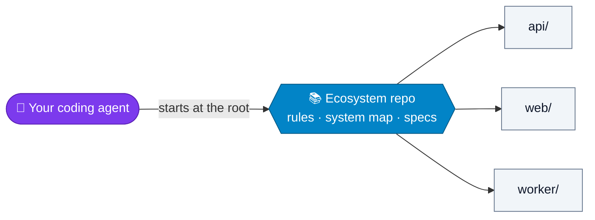
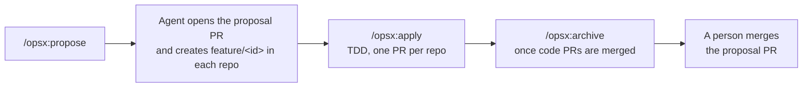

# agent-ecosystem

**Your repositories are an ecosystem. Give your AI coding agents the whole picture.**

Coding agents are great inside one repository, but most systems span several repositories: an agent working in
one of them cannot see the dependences with other repositories, so it proposes changes that are reasonable in isolation and
break something else. This template turns the folder where you clone all your services into a repo of its own,
the **ecosystem repository**, that gives every agent the shared rules, the contracts between
services and a spec-driven process for changes that cross repositories.



Works with any agent [OpenSpec](https://github.com/Fission-AI/OpenSpec) supports (Claude
Code, Cursor, Codex, GitHub Copilot and others), on GitHub or GitLab. Tested with OpenSpec
1.13.2.

## Quick start

**Adopting it for your team** (one person, once; the full guide is [SETUP.md](SETUP.md)):

1. Click **Use this template** (or clone it and push it to your git host) and keep the new
   repo **private**: it describes how your system works and where it is fragile.
2. List your service repos in `repos.txt` and run `make sync`: it clones them side by side.
3. Install OpenSpec and run `openspec init --tools claude` (or the agents your team uses).
4. Fill in `docs/system-map.md` and `docs/product/`, then run `make doctor` until
   it shows no errors.

**Joining a team that already uses it:**

```bash
git clone <your-ecosystem-url> ecosystem && cd ecosystem
make sync          # or make sync-all to also clone the optional repos
npm install -g @fission-ai/openspec@<X.Y.Z>
```

Every `make` command is a shortcut for `bootstrap.sh` (see [Daily use](#daily-use)): without
`make`, run `./bootstrap.sh` directly.

Then start your agent from the ecosystem root, never from inside a service repo. Quick
check: ask it "what does AGENTS.md say about when to read the system map?". If it answers
with the ecosystem rules, everything is wired up.

## How a change flows



The full rules are in `AGENTS.md`. `/opsx:*` commands run in the agent's chat, from the
ecosystem root; everything else runs in the terminal. Commands are shown for GitHub; on
GitLab use `glab mr create --target-branch <main>`.

| # | Step | Command |
| --- | --- | --- |
| 1 | (Optional) Explore the idea before proposing | `/opsx:explore` |
| 2 | Create the proposal (proposal, design, specs and tasks). The agent then opens the proposal's PR (`spec: <id>`, merged only at the end) and creates `feature/<id>` in the affected repos | `/opsx:propose <description>` |
| 3 | Implement task by task, with TDD. Progress in `tasks.md` is pushed to `spec/<id>` | `/opsx:apply <id>` |
| 4 | If the expected behaviour changes: update the proposal on `spec/<id>` and note it in its PR description | `/opsx:update <id>` |
| 5 | Open one PR per repo, with `<id>` in the title and a link to the proposal's PR | `gh pr create --base <main>` |
| 6 | (Optional) Check the implementation meets the proposal | `/opsx:verify <id>` |
| 7 | Once every code PR is merged: archive the proposal on `spec/<id>`, which gets its PR ready for review | `/opsx:archive <id>` |
| 8 | Review and merge the proposal's PR: a person does it | Git host |

Step-by-step guides: [new features](docs/workflows/feature.md) and
[bug fixes](docs/workflows/bugfix.md). A dropped change is
[abandoned](docs/workflows/feature.md#abandoning-a-change), not archived.

<details>
<summary><b>Bug fixes and abandoning a change</b></summary>

**Bug fix** (no proposal, unless it changes expected behaviour, touches a sensitive area or
changes a contract): root cause first, a test that reproduces the bug, a minimal fix.

| # | Step | Command |
| --- | --- | --- |
| 1 | Create the branch in the affected repos | `make branch NAME=fix/<short-description> REPOS="<repo> ..."` |
| 2 | Reproduce, find the root cause and write the failing test | — |
| 3 | Fix and open one PR per repo | `gh pr create --base <main>` |

**Abandoning a change**

| # | Step | Command |
| --- | --- | --- |
| 1 | Close the proposal's PR without merging, with the reason in a comment | Git host |
| 2 | Close the open code PRs and revert the ones already merged | Git host |
| 3 | Delete `spec/<id>` and `feature/<id>` | `git push origin --delete <branch>` |

</details>

<details>
<summary><b>Example: export orders to CSV</b></summary>

A feature that touches `api` (an export endpoint) and `web` (a button).

```bash
# In the agent: the proposal, with id export-orders-csv
/opsx:propose Let users export their order list to CSV from the web app
# Then, on its own, the agent opens the PR "spec: export-orders-csv" (it stays open until
# the end) and creates the branches with ./bootstrap.sh branch export-orders-csv:
#    repos of the change: api web
# -> api: created feature/export-orders-csv from main
# -> web: created feature/export-orders-csv from main

# In the agent: implement. Ticked tasks, and every change to the proposal made with
# /opsx:update, are pushed to spec/export-orders-csv
/opsx:apply export-orders-csv

# One PR per repo, with the id in the title:
#   api: "export-orders-csv: CSV export endpoint"
#   web: "export-orders-csv: Export to CSV button"

# Once both code PRs are merged, in the agent:
/opsx:archive export-orders-csv
# The agent pushes the archive to spec/export-orders-csv and says the proposal's PR is
# ready. A person reviews and merges it: the spec then lives in openspec/specs/.
```

</details>

## What's in the template

```
your-ecosystem/                 ← this template
├── AGENTS.md                   ← shared rules for every agent
├── CLAUDE.md                   ← imports AGENTS.md for Claude Code
├── bootstrap.sh                ← clones and updates the service repos
├── Makefile                    ← make shortcuts for bootstrap.sh and every repo
├── repos.txt                   ← list of service repos
├── docs/
│   ├── system-map.md           ← contracts between services
│   ├── product/                ← sensitive areas, constraints, glossary, decisions
│   └── workflows/              ← step-by-step guides: features and bug fixes
├── openspec/                   ← specs and changes for the whole system
├── templates/                  ← proposal PR description; per-repo AGENTS.md, CLAUDE.md, PR template
├── tests/                      ← tests for bootstrap.sh and the Makefile
├── api/                        ← service repos: own git, ignored by the ecosystem repo
├── web/
└── worker/
```

- **Rules for agents** (`AGENTS.md`): how the team works, once, for every agent. Without it,
  each developer ends up feeding the agent context their own way.
- **A system map** (`docs/system-map.md`): the contracts between services — the thing an
  agent in a single repo can never see.
- **Product context** (`docs/product/`): sensitive areas, external constraints, glossary
  and decisions — what cannot be read in the code.
- **OpenSpec** (`openspec/`): one proposal per change, even when it spans several repos,
  published in a PR before any code is written and merged once the change is built.
- **`bootstrap.sh`**: gives everyone the same folder layout and keeps every repo's main
  branch up to date without ever touching your work.

## Daily use

Run them from the ecosystem root. `make help` lists them; each one calls `bootstrap.sh`,
which you can also run directly.

| `make` | `bootstrap.sh` | What it does |
| --- | --- | --- |
| `make sync` | `./bootstrap.sh` | Clones missing repos and brings every repo's main branch up to date, whatever branch you are on |
| `make sync-all` | `./bootstrap.sh --all` | Same, including optional repos |
| `make status` | `./bootstrap.sh status` | Branch and state of every repo |
| `make branch NAME=<branch> REPOS="<repo> ..."` | `./bootstrap.sh branch <branch> <repo>...` | Creates the branch from the main branch (or switches to it) in several repos |
| `make branch ID=<id>` | `./bootstrap.sh branch <id>` | Same, with `feature/<id>` in the repos tagged in the `tasks.md` of `spec/<id>`. Only if the proposal's PR is open |
| `make check-spec ID=<id>` | `./bootstrap.sh check-spec <id>` | Says, without creating anything, whether the proposal `<id>` is published (PR open), merged or archived |
| `make doctor` | `./bootstrap.sh doctor` | Checks the ecosystem repo is filled in and set up: placeholders, TODOs, OpenSpec, system map age, files left out |
| `make tests` | `./bootstrap.sh tests` | Runs the tests of `bootstrap.sh` and the Makefile, and shellcheck if installed |
| `make <repo>/<target>` | — | Runs `make <target>` in that repo from the root, e.g. `make api/test` |

The script never deletes anything, never switches your branch and never touches your files:

- **On the main branch, clean:** pulls.
- **On another branch:** updates your local main branch in the background, without moving you.
- **On the main branch with uncommitted changes:** only fetches; pull once you commit.

<details>
<summary><b>If you use an SSH alias or HTTPS</b></summary>

`repos.txt` always uses the canonical URL. If you reach the git host through another host
name (an alias in `~/.ssh/config`, a second account, or HTTPS), do not edit `repos.txt`;
tell git to rewrite the URL, once:

```bash
# SSH alias (e.g. Host github-work in ~/.ssh/config)
git config --global url."git@github-work:".insteadOf "git@github.com:"

# HTTPS instead of SSH
git config --global url."https://github.com/".insteadOf "git@github.com:"
```

</details>

## Design choices

- **An ecosystem repo, not a monorepo.** Same shared context, no migration of history, CI or
  deployments.
- **The shared knowledge is plain markdown.** It outlives any tool: if you replace OpenSpec
  one day, the system map and product context stay.
- **Minimal by default.** No orchestration layer, no extra CLI, no skill packs. Add more
  only when an agent actually fails in a way rules cannot fix.
- **One ecosystem PR per change, merged at the end.** The proposal's PR is opened before any
  code and merged once the change is built, with the archive, so the main branch only gets
  what was built. The accepted risk: code can be merged before the spec is reviewed. Changes
  that need agreement first (sensitive areas, contracts) get their review before starting.
- **Humans approve, agents never merge.** The agent can open PRs, but it never approves or
  merges anything.

## Requirements

- Bash (macOS, Linux, or WSL / Git Bash on Windows) and git 2.23+.
- `make` for the shortcuts (optional: `./bootstrap.sh` does the same).
- Node.js 20.19+ for the OpenSpec CLI.
- `gh` or `glab` if you want agents to open PRs for you.

## License

[MIT](LICENSE)